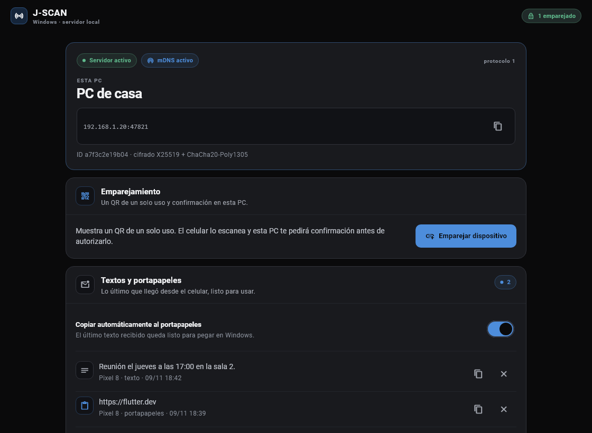
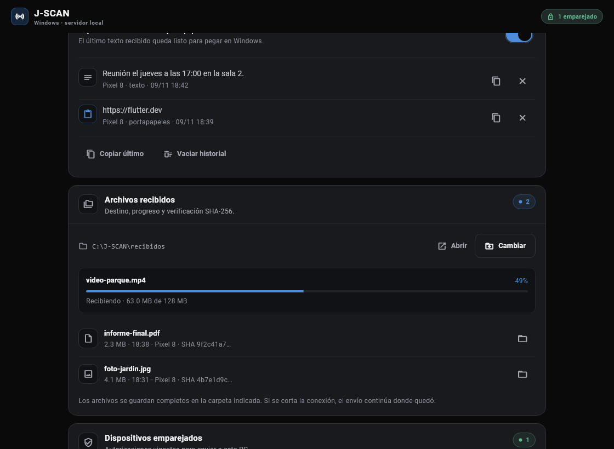
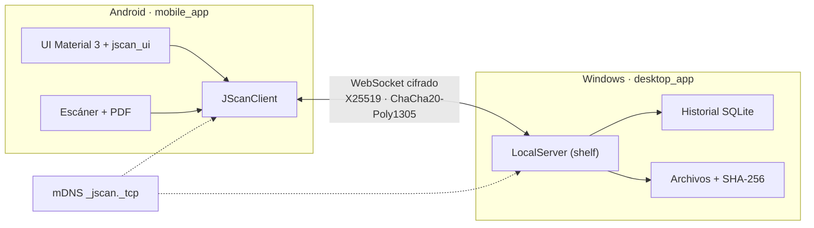

<p align="center">
  
</p>

<h1 align="center">J-SCAN</h1>

<p align="center">
  <strong>Del celular a la PC, por tu red local y cifrado.</strong><br>
  Envía texto, archivos y documentos escaneados de Android a Windows sin nube ni internet.
</p>

<p align="center">
  
  <a href="LICENSE">
    
  </a>
  
  
</p>

---

## ¿Qué es J-SCAN?

J-SCAN conecta un celular Android con una PC Windows en la misma red Wi-Fi o
LAN. Sirve para pasar cosas rápido entre ambos equipos:

- enviar texto, enlaces o el portapapeles a la PC;
- transferir archivos, fotos y videos con progreso, cancelación y reanudación;
- escanear hojas con la cámara, aplicar filtros y mandar el PDF directamente a la PC.

Todo viaja **cifrado de extremo a extremo** y **nunca sale de la red local**. No
hay cuentas, servidores en la nube ni conexión a internet.

## Capturas

<p align="center">
  
  
</p>

## Descargas

La beta **0.2.1** está publicada en
[GitHub Releases](https://github.com/jr-0205/j-scan/releases/tag/v0.2.1):

| Archivo | Para qué sirve |
|---|---|
| `JScan-Setup-0.2.1.exe` | Instalador de Windows 10/11, por usuario y sin permisos de administrador. |
| `app-arm64-v8a-release.apk` | Celulares Android actuales (64 bits). |
| `app-armeabi-v7a-release.apk` | Celulares Android antiguos de 32 bits. |
| `app-x86_64-release.apk` | Emuladores y equipos con CPU Intel. |

Los APK de esta beta usan una firma de desarrollo; instálalos solo desde esta
release y con la opción de orígenes desconocidos habilitada.

## Características

- **Descubrimiento automático** de la PC por mDNS (`_jscan._tcp.local`).
- **Emparejamiento con QR** de un solo uso y confirmación explícita en la PC.
- **Cifrado** X25519 + HKDF-SHA256 + ChaCha20-Poly1305 en todos los mensajes
  posteriores a la autenticación.
- **Texto y portapapeles** con confirmación de entrega e historial SQLite en la PC.
- **Archivos** por partes con progreso, cancelación, reanudación tras cortes y
  verificación SHA-256 (hasta 8 GiB por archivo).
- **Compartir desde otras apps** de Android con `Compartir → J-SCAN`.
- **Escáner** con detección de bordes, corrección de perspectiva, recorte manual,
  rotación, reordenación y filtros (original, color, gris y blanco y negro).
- **PDF A4** de varias páginas con nombre editable y presets de calidad.
- **Servicio en primer plano** para envíos largos con la pantalla apagada.
- **Interfaz oscura compartida** entre Android y Windows (`packages/jscan_ui`).

## Cómo funciona



El protocolo está documentado en [`docs/protocol.md`](docs/protocol.md) y se
mantiene en **v1**.

## Estructura del monorepo

```text
J-SCAN/
├── apps/
│   ├── desktop_app/   Flutter Windows · servidor, QR, bandeja e historial
│   └── mobile_app/    Flutter Android · descubrimiento, envío, escáner y PDF
├── packages/
│   ├── jscan_core/    Dart puro · protocolo, cifrado, servidor, cliente y mDNS
│   └── jscan_ui/      Flutter · tokens, tema oscuro y componentes compartidos
├── docs/              protocolo, arquitectura, guías y wireframes
├── tool/              utilidades del repositorio
└── melos.yaml         scripts del monorepo
```

| Paquete | Rol |
|---|---|
| `jscan_core` | Lógica compartida sin Flutter: protocolo, criptografía, servidor, cliente, mDNS y archivos. |
| `jscan_ui` | Sistema visual: paleta grafito, tema oscuro único y componentes reutilizables. |
| `desktop_app` | App de Windows: servidor local, QR de emparejamiento, historial y recepción de archivos. |
| `mobile_app` | App de Android: descubrimiento, emparejamiento, envíos, escáner y PDF. |

## Requisitos

- **Flutter 3.47 o superior** (Dart incluido).
- **Windows 10/11** para la app de escritorio.
- **Android 8+** para el celular.
- PC y celular en la **misma red** Wi-Fi o LAN. No hace falta internet.

## Puesta en marcha

```bash
git clone https://github.com/jr-0205/j-scan.git
cd J-SCAN
dart pub global activate melos
melos bootstrap
```

Sin Melos, instala cada paquete por separado:

```bash
cd packages/jscan_core && dart pub get
cd ../../apps/desktop_app && flutter pub get
cd ../mobile_app && flutter pub get
```

### App de escritorio (Windows)

```bash
cd apps/desktop_app
flutter run -d windows
```

La PC abre el puerto **47821**, publica el servicio por mDNS y muestra el QR de
emparejamiento. Al cerrar la ventana se detienen el servidor y el anuncio mDNS, y
la app termina.

Para generar el ejecutable y el instalador:

```bash
flutter build windows --release
powershell -ExecutionPolicy Bypass -File tool/build_installer.ps1
```

El instalador usa **Inno Setup 6** y se instala por usuario, sin permisos de
administrador. El resultado queda en `apps/desktop_app/build/installer/`.

### App Android

```bash
cd apps/mobile_app
flutter run -d <id-del-dispositivo>
```

Para compilar el APK de prueba:

```bash
flutter build apk --debug
```

El artefacto queda en `apps/mobile_app/build/app/outputs/flutter-apk/app-debug.apk`.

La primera vez Android pedirá permiso de cámara y notificaciones. Si deniegas la
cámara, todavía puedes emparejar con **Pegar código** y enviar archivos.

## Pruebas

```bash
# Protocolo, cifrado, emparejamiento, servidor/cliente, archivos y mDNS E2E
cd packages/jscan_core
dart test

# Widgets, historial SQLite y flujos de UI
cd apps/desktop_app && flutter test
cd ../mobile_app && flutter test

# Análisis estático
dart analyze                  # jscan_core
flutter analyze               # cada app y jscan_ui
```

La integración continua de GitHub Actions ejecuta formato, análisis, pruebas y
el build de Windows. El flujo está en
[`.github/workflows/ci.yml`](.github/workflows/ci.yml).

## Seguridad y privacidad

- La clave se acuerda con **X25519** y nunca viaja por la red.
- Todos los mensajes autenticados usan **ChaCha20-Poly1305**; las comparaciones de
  tokens, MACs y claves públicas son en tiempo constante.
- La PC solo acepta dispositivos confirmados manualmente y puede revocarlos.
- Los archivos se guardan únicamente en la carpeta elegida; los parciales y
  exportaciones temporales se limpian solos.
- No hay telemetría, cuentas ni servidores externos.

¿Encontraste una vulnerabilidad? Consulta [`SECURITY.md`](SECURITY.md) para
reportarla de forma privada.

## Documentación

- [Cómo ejecutar y probar](docs/getting-started.md)
- [Guía rápida para la beta](docs/guia-rapida.md)
- [Protocolo v1](docs/protocol.md)
- [Arquitectura](docs/architecture.md)
- [Wireframes](docs/wireframes.md)

## Estado del proyecto

Los sprints 0 a 7 están implementados y la beta actual es **0.2.1**. Queda
pendiente la validación manual en varios modelos de celular y redes reales; la
lista está en la [guía rápida](docs/guia-rapida.md#8-lista-de-verificación-de-la-beta).

La integración continua de GitHub está en pausa por una restricción de la
cuenta. Cada versión se verifica localmente con `flutter analyze`, las pruebas
automatizadas y los builds release de Android y Windows.

## Contribuir

Las contribuciones son bienvenidas. Antes de abrir un pull request:

1. ejecuta `dart format .`, `flutter analyze` y las pruebas del paquete o app que
   hayas tocado;
2. mantén el protocolo en **v1** salvo que el cambio esté documentado y probado;
3. describe el problema, la solución y cómo lo verificaste.

Para fallos, incluye modelo de celular, versión de Android, versión de Windows,
tipo de red y el mensaje de error completo. Más detalles en
[`CONTRIBUTING.md`](CONTRIBUTING.md).

## Licencia

Este proyecto se distribuye bajo la licencia **MIT**. Consulta
[`LICENSE`](LICENSE).
